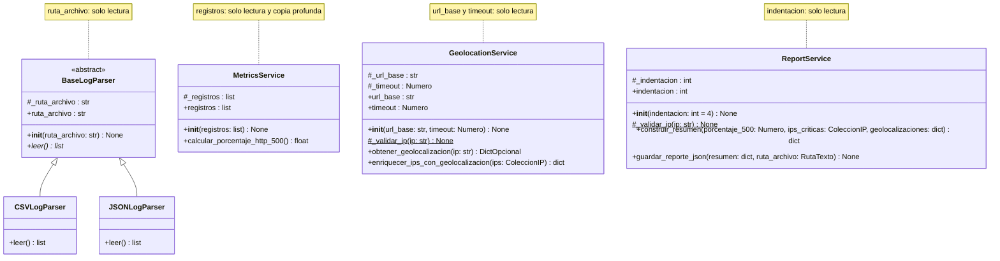
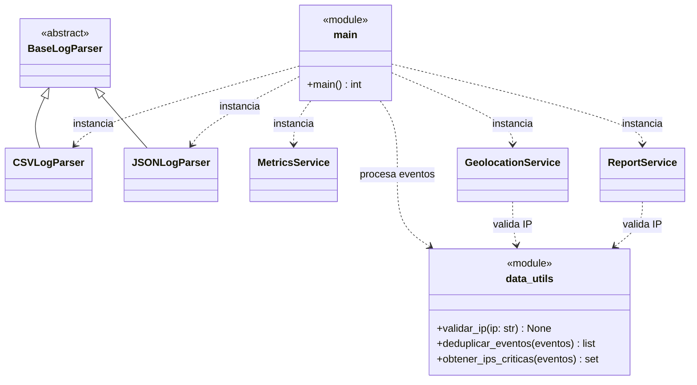
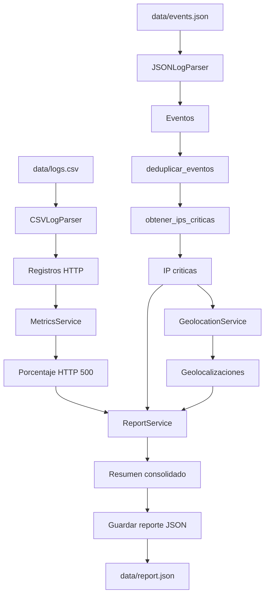

# Diagrama UML de Clases — TI-Metrics

## 1. Hito 2: Arquitectura Orientada a Objetos

Este documento representa la arquitectura actual de TI-Metrics,
sus clases, atributos, propiedades, métodos, relaciones de herencia
y dependencias entre componentes.

El sistema utiliza seis clases principales: una clase abstracta,
dos parsers concretos y tres servicios especializados.

## 2. Diagrama UML de clases

## 3. Convenciones UML

| Notacion | Significado |
|---|---|
| `+` | Miembro publico. |
| `#` | Miembro no publico, representado como protegido. |
| `-` | Miembro privado en la notacion UML. |
| `*` | Metodo abstracto en Mermaid. |
| `$` | Metodo estatico en Mermaid. |
| `<\|--` | Relacion de herencia. |
| `..>` | Relacion de dependencia. |

En Python, el prefijo de un guion bajo indica que un miembro
es no publico por convencion. No impide tecnicamente su acceso.

Las propiedades publicas representadas en el diagrama utilizan
el decorador `@property` y no tienen setters.

Los constructores y las propiedades heredados no se duplican
en las clases hijas.

## 4. Tipos de datos y firmas

Para facilitar la lectura del diagrama Mermaid se utilizan
las siguientes abreviaturas documentales:

| Abreviatura | Tipo conceptual en Python |
|---|---|
| `Numero` | `int` o `float`. |
| `DictOpcional` | `dict` o `None`. |
| `ColeccionIP` | `list`, `tuple`, `set` o `frozenset` de cadenas IP. |
| `RutaTexto` | `str` o `PathLike` que represente una ruta de texto. |

Estas abreviaturas no representan clases ni alias de tipos
declarados en el codigo fuente.

### 4.1. Tipos explicitamente anotados

- `BaseLogParser.__init__`: parametro `ruta_archivo` de tipo `str`.
- `BaseLogParser.ruta_archivo`: retorno `str`.
- `MetricsService.__init__`: parametro `registros` de tipo `list`.
- `MetricsService.registros`: retorno `list`.
- `MetricsService.calcular_porcentaje_http_500`: retorno `float`.
- `GeolocationService.__init__`: parametros `str` e `int | float`;
  retorno `None`.
- `GeolocationService.url_base`: retorno `str`.
- `GeolocationService.timeout`: retorno `int | float`.
- `GeolocationService._validar_ip`: parametro `str` y retorno `None`.
- `ReportService.__init__`: parametro `indentacion` de tipo `int`.
- `ReportService.indentacion`: retorno `int`.
- `ReportService._validar_ip`: parametro `str` y retorno `None`.
- `ReportService.construir_resumen`: retorno `dict`.
- `ReportService.guardar_reporte_json`: retorno `None`.

### 4.2. Tipos inferidos de la implementacion

- Los constructores inicializan objetos y retornan `None`,
  aunque no todos poseen una anotacion explicita de retorno.
- El retorno `list` de `BaseLogParser.leer()` representa el
  contrato conceptual observado en sus implementaciones concretas.
- `CSVLogParser.leer()` retorna una lista de diccionarios.
- `JSONLogParser.leer()` retorna una lista de diccionarios.
- `GeolocationService.obtener_geolocalizacion()` recibe una IP
  de tipo `str` y retorna un diccionario o `None`.
- `GeolocationService.enriquecer_ips_con_geolocalizacion()`
  recibe una coleccion de IP y retorna un diccionario.
- Los parametros de los metodos de construccion y persistencia
  de reportes se documentan segun sus validaciones.

Los tipos inferidos no deben confundirse con anotaciones
existentes en el codigo fuente.

### 4.3. Valores predeterminados

| Clase | Parametro | Valor predeterminado |
|---|---|---|
| GeolocationService | url_base | `http://ip-api.com/json` |
| GeolocationService | timeout | `5` segundos |
| ReportService | indentacion | `4` espacios |

## 5. Dependencias arquitectonicas

El modulo `src/main.py` coordina la ejecucion de las cinco
clases concretas y las funciones auxiliares de procesamiento.

Los elementos `main` y `data_utils` son modulos de Python,
no clases adicionales del sistema.

### 5.1. Relaciones internas

| Componente de origen | Componente utilizado | Relacion |
|---|---|---|
| CSVLogParser | BaseLogParser | Herencia |
| JSONLogParser | BaseLogParser | Herencia |
| main | CSVLogParser | Dependencia |
| main | JSONLogParser | Dependencia |
| main | MetricsService | Dependencia |
| main | GeolocationService | Dependencia |
| main | ReportService | Dependencia |
| main | data_utils | Dependencia |
| GeolocationService | data_utils | Dependencia |
| ReportService | data_utils | Dependencia |

No se identifican relaciones directas de asociacion,
agregacion o composicion entre las seis clases principales.

Los servicios reciben datos mediante parametros, en lugar
de almacenar instancias de los otros servicios.

### 5.2. Dependencias externas

| Componente | Dependencia | Responsabilidad |
|---|---|---|
| BaseLogParser | abc | Abstraccion y metodos abstractos. |
| CSVLogParser | csv | Lectura de archivos CSV. |
| Modulo csv_parser | pathlib | Compatibilidad con rutas Path. |
| JSONLogParser | json | Lectura de archivos JSON. |
| Modulo json_parser | os | Compatibilidad con rutas PathLike. |
| MetricsService | copy | Copias profundas de registros. |
| GeolocationService | math | Validacion de valores finitos. |
| GeolocationService | urllib.parse | Analisis de URL. |
| GeolocationService | requests | Peticiones HTTP. |
| GeolocationService | IP-API | Servicio externo de geolocalizacion. |
| ReportService | json | Serializacion JSON. |
| ReportService | os | Normalizacion de rutas. |
| data_utils | ipaddress | Validacion de direcciones IP. |
| data_utils | math | Validacion de valores numericos finitos. |
| main | sys | Salida de errores. |

## 6. Flujo de procesamiento

El siguiente diagrama representa el flujo de datos coordinado
por la funcion `main()`.

Este diagrama representa transferencias de datos y no implica
relaciones de composicion o agregacion entre clases.

Tampoco representa ejecucion paralela: el procesamiento real
se realiza secuencialmente dentro de `main()`.

La funcion retorna `0` cuando la ejecucion es satisfactoria
y `1` cuando captura errores de tipo `OSError`, `ValueError`
o `TypeError`.

## 7. Validaciones y encapsulamiento

### BaseLogParser

- Valida que la ruta sea una cadena de texto no vacia.
- Conserva la ruta en un atributo interno.
- Expone una propiedad publica de solo lectura.

### CSVLogParser

- Verifica los encabezados obligatorios.
- Convierte el estado HTTP y el tiempo de respuesta a enteros.
- Valida estados HTTP entre 100 y 599.
- Rechaza tiempos de respuesta negativos e IP vacias.
- Contextualiza errores de archivos y registros.

### JSONLogParser

- Verifica que el documento contenga una lista de eventos.
- Exige que cada evento sea un diccionario.
- Valida los campos obligatorios `ip`, `event` y `severity`.
- Contextualiza errores de lectura y decodificacion JSON.

### MetricsService

- Valida la estructura de los registros.
- Exige estados HTTP enteros entre 100 y 599.
- Excluye valores booleanos como estados HTTP.
- Utiliza copias profundas al almacenar y devolver registros.
- Retorna `0.0` cuando no existen registros.

### GeolocationService

- Valida la URL base y su protocolo HTTP o HTTPS.
- Exige un timeout numerico, positivo y finito.
- Excluye valores booleanos como timeout.
- Valida las IP mediante una funcion compartida.
- Valida todas las IP antes de iniciar consultas multiples.
- Retorna `None` ante respuestas no satisfactorias y
  excepciones de comunicacion capturadas.

### ReportService

- Valida la indentacion como entero no negativo.
- Excluye valores booleanos como indentacion.
- Valida porcentajes numericos finitos entre 0 y 100.
- Valida las IP criticas y los datos de geolocalizacion.
- Ordena lexicograficamente las IP recibidas como conjuntos.
- Conserva el orden de las listas y tuplas recibidas.
- Valida las rutas de persistencia.
- Serializa los datos antes de abrir el archivo en escritura.
- Conserva caracteres Unicode y rechaza valores no finitos.
- Contextualiza errores de serializacion, rutas y permisos.

## 8. Conceptos de Programacion Orientada a Objetos

### Abstraccion

`BaseLogParser` define el contrato abstracto `leer()` que
deben implementar los parsers concretos.

### Herencia

`CSVLogParser` y `JSONLogParser` heredan el constructor,
la propiedad de ruta y el contrato de lectura de `BaseLogParser`.

### Polimorfismo

Ambos parsers implementan el metodo `leer()` de manera
especializada, permitiendo utilizar una interfaz comun
para procesar diferentes formatos de archivo.

### Encapsulamiento

Los atributos internos se identifican mediante un guion bajo
y se exponen mediante propiedades publicas de solo lectura.

`MetricsService` protege adicionalmente sus registros mediante
copias profundas.

### Bajo acoplamiento

Los servicios trabajan con listas, diccionarios, conjuntos
y valores numericos, sin depender directamente de instancias
de los otros servicios principales.

### Reutilizacion

`GeolocationService` y `ReportService` delegan la validacion
de direcciones IP a `data_utils.validar_ip()`.

## 9. Compatibilidad con el Hito 1

Se conservan siete funciones independientes que delegan
sus responsabilidades a las clases correspondientes.

| Funcion de compatibilidad | Clase responsable |
|---|---|
| leer_logs_csv | CSVLogParser |
| leer_eventos_json | JSONLogParser |
| calcular_porcentaje_http_500 | MetricsService |
| obtener_geolocalizacion | GeolocationService |
| enriquecer_ips_con_geolocalizacion | GeolocationService |
| construir_resumen | ReportService |
| guardar_reporte_json | ReportService |

Estas funciones wrapper no son metodos adicionales de las
clases y conservan la interfaz funcional del Hito 1.

## 10. Limitaciones de la arquitectura

- Las propiedades de solo lectura no impiden el acceso directo
  a los atributos internos mediante las convenciones de Python.
- Los parsers comprueban que las IP no esten vacias, pero la
  validacion de su formato se realiza en otras etapas.
- La URL predeterminada de geolocalizacion utiliza HTTP.
- La disponibilidad de la geolocalizacion depende de una API externa.
- Las consultas multiples pueden repetir peticiones si reciben
  direcciones duplicadas.
- El retorno `None` no distingue todas las causas de fallo
  de una consulta de geolocalizacion.
- ReportService conserva la referencia al diccionario de
  geolocalizaciones recibido.
- No se exige igualdad entre las IP criticas y las claves
  del diccionario de geolocalizaciones.
- La serializacion preventiva no constituye una escritura atomica.
- Los directorios de destino deben existir previamente.
- Las rutas relativas de main requieren ejecutar el programa
  desde la raiz del proyecto.

## 11. Inventario de la arquitectura

| Elemento | Cantidad |
|---|---:|
| Clases principales | 6 |
| Clases abstractas | 1 |
| Clases concretas | 5 |
| Atributos internos declarados | 5 |
| Propiedades de solo lectura | 5 |
| Constructores explicitos | 4 |
| Metodos ordinarios | 8 |
| Metodos abstractos incluidos en los ordinarios | 1 |
| Metodos estaticos | 2 |
| Funciones wrapper | 7 |
| Relaciones de herencia | 2 |
| Dependencias internas documentadas | 8 |
| Diagramas Mermaid | 3 |

El inventario contabiliza los miembros declarados directamente
en cada clase, sin duplicar los miembros heredados.
