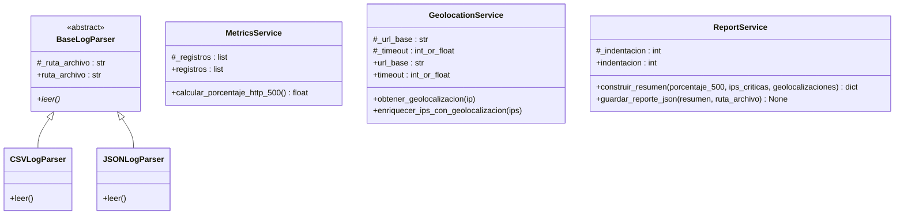

# Diagrama UML de Clases — TI-Metrics

## Hito 2: Arquitectura Orientada a Objetos

Este diagrama representa las clases principales del sistema TI-Metrics,
sus atributos, métodos y relaciones de herencia.

## Conceptos de Programación Orientada a Objetos

### Abstracción
BaseLogParser define el contrato común de lectura mediante
el método abstracto leer().

### Herencia
CSVLogParser y JSONLogParser heredan de BaseLogParser.

### Polimorfismo
Ambas clases implementan leer(), pero procesan formatos
de archivo diferentes: CSV y JSON.

### Encapsulamiento
Las clases utilizan atributos protegidos y propiedades
@property para controlar el acceso a su estado interno.

### Integración
El módulo src/main.py coordina los analizadores y servicios
para procesar registros, calcular métricas, geolocalizar
direcciones IP críticas y generar el reporte JSON.
